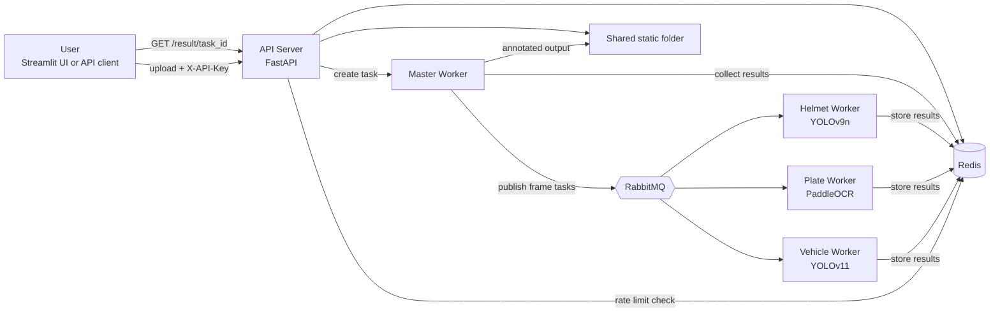
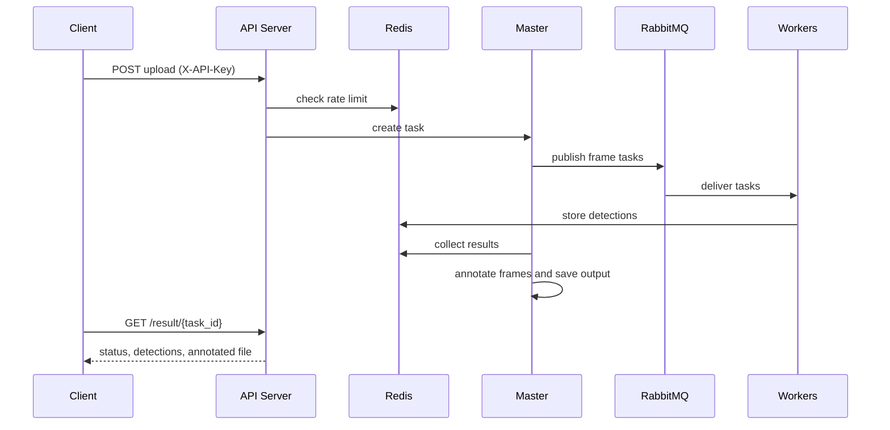
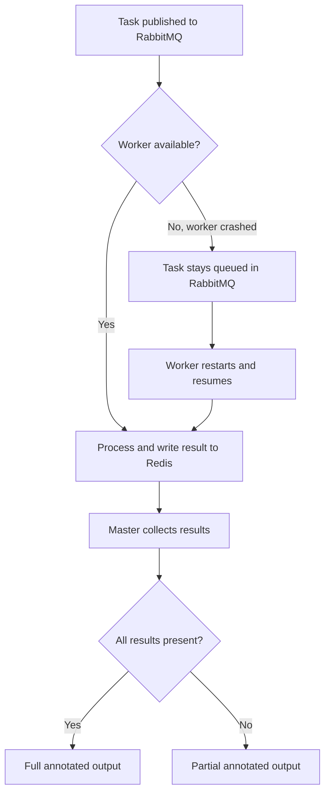

# Distributed Traffic Surveillance System

A fault-tolerant, distributed system that detects vehicles, reads license plates, and flags helmet violations in images and video. Work is split across independent workers connected by a message queue, so one failing component does not stop the rest.

**Stack:** FastAPI · RabbitMQ · Redis · YOLO · PaddleOCR · OpenCV · Streamlit · Docker Compose

---

## What it does

- Accepts an image or video through a web UI or a REST API
- Splits video into frames and processes them in parallel across specialised workers
- Detects vehicles (YOLOv11), reads license plates (PaddleOCR), and detects helmet violations (YOLOv9n)
- Returns an annotated result plus structured detections
- Keeps working with partial results when one worker is down

---

## Architecture



### Request flow



---

## Components

| Service | Folder | Role |
|---|---|---|
| API Server | `api_server/` | Handles uploads, authentication, rate limiting, and result retrieval |
| Master Worker | `master_worker/` | Splits input into frames, dispatches tasks, collects and annotates results |
| Vehicle Worker | `vehicle_worker/` | Detects vehicles with YOLOv11 |
| Plate Worker | `plate_worker/` | Extracts license plate text with PaddleOCR |
| Helmet Worker | `helmet_worker/` | Detects helmet violations with YOLOv9n |
| Frontend | `frontend/` | Streamlit UI to upload files and view results |
| Shared storage | `static/`, `models/` | Annotated outputs and model weights |

---

## Fault tolerance



- The master retries its Redis and RabbitMQ connections until both are ready
- If a worker crashes, its tasks stay in RabbitMQ until a worker picks them up again
- Annotated output is still produced when only some results are available

**Try it yourself:**

```bash
docker-compose stop helmet_worker
# upload a task and watch the other workers continue
docker-compose start helmet_worker
```

---

## Quick start

**Requirements:** Docker, Docker Compose, and 8 GB+ RAM recommended.

```bash
git clone https://github.com/Sumanth3036/Distributed-Traffic-Surveillance-System.git
cd Distributed-Traffic-Surveillance-System
docker-compose up --build
```

| Interface | URL |
|---|---|
| Streamlit UI | http://localhost:8501 |
| FastAPI docs | http://localhost:8000/docs |
| RabbitMQ dashboard | http://localhost:15672 (guest / guest) |

---

## API

Every request needs an API key header:

```http
X-API-Key: <your-key>
```

- Rate limit: 10 requests per minute per key, enforced in Redis
- Results are available at `GET /result/{task_id}`
- The demo key in this repo is for local testing only. Change it before any real deployment.

---

## Limitations

- Built as a prototype and tested locally with Docker Compose, not in production
- Detection quality depends on the YOLO weights and input quality
- Default credentials and the demo API key must be replaced for any real use

---

## Author

Built by **Sumanth Ponugupati** · [LinkedIn](https://www.linkedin.com/in/sumanthponugupati/) · [Portfolio](https://sumanth3036.github.io/my-portfolio/)

## License

MIT
